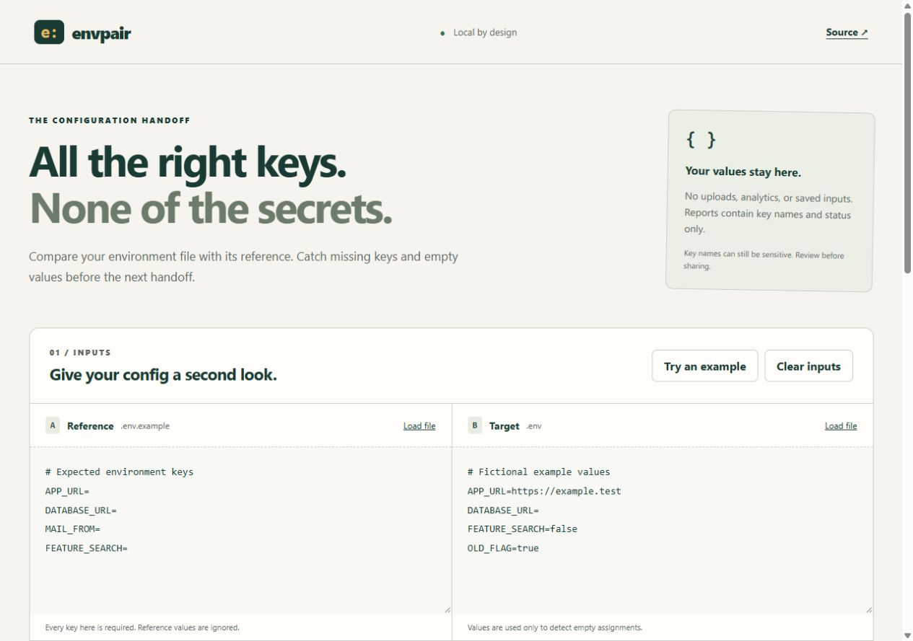
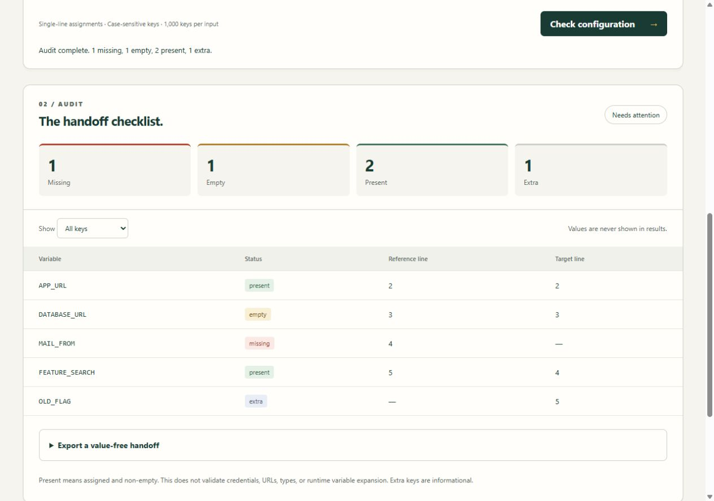

# Envpair

[Open envpair](https://envpair-five.vercel.app)

**All the right keys. None of the secrets.**

Check a `.env` file against its reference before a configuration handoff. Envpair identifies missing keys, empty assignments, and extra keys, with line-number diagnostics for duplicates and unsupported syntax. Export a checklist without including configuration values.



## What it does

- Compares case-sensitive keys from `.env.example` and `.env` without line-order noise.
- Separates **missing**, **empty**, **present**, and **extra** assignments.
- Blocks ambiguous reports when either input contains duplicates or invalid syntax.
- Filters the report down to keys needing attention.
- Exports JSON, a Markdown checklist, a blank reference template, or an unresolved-key worksheet.
- Offers a dependency-free CLI with useful exit codes for local checks and CI.
- Runs the browser audit locally, with no uploads, analytics, external fonts, or app storage.



## Run locally

Requires Node.js 20 or newer. No dependency installation is needed.

```sh
git clone https://github.com/KingReaper6940/envpair.git
cd envpair
npm run dev
```

Open **http://127.0.0.1:4180**. Choose **Try an example**, or paste/load your reference and target files, then select **Check configuration**. Every reference key is required, regardless of its reference value. A target containing `false` or `0` counts as present; quoted whitespace counts as empty.

Open **Export a value-free handoff** to inspect the exact output before copying or downloading it. The unresolved worksheet includes only missing/empty keys: fill its values and merge manually. It is not a replacement for your existing `.env` file. The app never edits files on disk.

### Command line

```sh
node scripts/check.mjs examples/reference.txt examples/target.txt
node scripts/check.mjs .env.example .env > env-report.json
```

The first example intentionally exits with code 1 and reports 1 missing, 1 empty, 2 present, and 1 extra key. [The complete expected report](examples/report.json) is included.

| Exit | Meaning |
| --- | --- |
| `0` | All required keys have non-empty assignments; extras are informational |
| `1` | Valid input, but required keys are missing or empty |
| `2` | Invalid/ambiguous input, unreadable file, input limit, or incorrect arguments |

Diagnostics use key names and line numbers. Raw values and input paths are not printed in error messages. Reports still disclose key names: review them before sharing or storing as CI artifacts.

## Supported syntax

Envpair uses a deliberately bounded format, **not a full shell or dotenv runtime**:

```dotenv
# Comments and blank lines are ignored
export APP_URL=https://example.test
DATABASE_URL=
LABEL="a # hash inside quotes" # outside comment
MAIL_FROM='team@example.test'
```

- Keys match `[A-Za-z_][A-Za-z0-9_]*`; names are case-sensitive.
- Optional `export`, surrounding assignment whitespace, LF/CRLF/CR, and a leading BOM are supported.
- Single-line unquoted, single-quoted, and double-quoted values are supported. Unquoted `#` starts a comment. Quoted `#` is preserved.
- Double-quote closing detection recognizes escaped characters; backslashes in single quotes are literal. Escape sequences are not decoded.
- A value is empty when its parsed text contains only whitespace, or no characters.
- Multiline quoted values, backtick values, bare keys, and trailing text after a quoted value are rejected.
- Duplicate keys block the audit rather than silently choosing first/last wins. An empty reference also blocks it.
- Each input is limited to **100,000 JavaScript string characters** and **1,000 unique keys**. The file reader also bounds bytes read to approximately 400 KB.

`${VARIABLE}` and `$(command)` are treated as literal text, never expanded or executed. Envpair cannot tell whether they resolve correctly in your runtime. It does not compare values between files, validate credentials/types/URLs, detect placeholder values, merge `process.env`, or inspect application source. A “present” result means a non-empty assignment exists; it is not a deployment readiness guarantee.

## Privacy

The browser app makes no data requests after loading its static assets. Its Content Security Policy blocks connections, and it uses no persistence APIs. Raw inputs remain visible in the editors and in page memory until cleared or the page closes. **Clear inputs** removes them from the app's UI/state; this is not a guarantee of forensic memory erasure. Copying/downloading a report creates data outside the app. Browser extensions and the environment hosting the page are outside this app's control. Run the inspected source locally for sensitive configurations.

## Test and build

```sh
npm test
npm run build
```

The 17 Node tests cover parsing, quote boundaries, duplicates, limits, case/prototype-name keys, comparison states, value omission in exports, unresolved worksheets, and CLI exit/error behavior. GitHub Actions runs tests and builds on Node 20/22 on Windows/Linux. The build checks browser-module syntax and emits a small static site to `dist/`.

Browser checks exercised the example, attention filter, JSON/unresolved previews, duplicate rejection, stale export clearing, and a fully assigned configuration. Layout was checked at 1280px and 390px, with no page-level horizontal overflow. Native file chooser, clipboard permission flows, and downloaded-file handling have not been independently verified end-to-end.

## Deploy manually to Vercel

Import this GitHub repository in your Vercel dashboard using:

| Setting | Value |
| --- | --- |
| Framework preset | Other |
| Root directory | `./` |
| Build command | `npm run build` |
| Output directory | `dist` |
| Install command | Empty / no dependencies |

`vercel.json` includes the build/output settings. No environment variables, database, paid APIs, or server functions are required. You can also serve the contents of `dist/` on any static host with JavaScript module MIME support.

## Project structure

`src/core.mjs` contains pure parsing, audit, and export functions shared by the browser and CLI. `src/app.mjs` handles DOM rendering and local exports; `scripts/check.mjs` is the bounded CLI reader. Example inputs contain only fictional data.

## References

Envpair's format takes cues from [dotenv's parsing rules](https://github.com/motdotla/dotenv#what-rules-does-the-parsing-engine-follow), with the explicit restrictions above. [dotenv-safe](https://github.com/rolodato/dotenv-safe) is an alternative when you want required environment variables checked inside a Node application's startup path.

MIT licensed. See [LICENSE](LICENSE).
